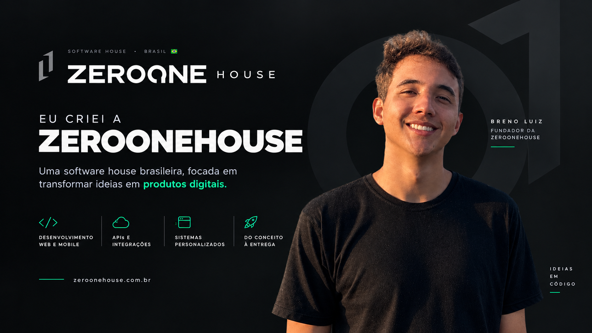

 

# Breno Luiz

**Software Engineer · Fullstack · Founder of ZeroOne House**

Building digital products from architecture to production.

---

## About

I'm a software engineer and founder of **[ZeroOne House](https://zeroonehouse.com.br)**, where I design, build and operate digital products — from database architecture and user interfaces to infrastructure and deployment.

My main stack revolves around **TypeScript, React, Next.js and Node.js**, with experience in Flutter, backend architecture, databases, Docker and CI/CD.

I'm also continuously developing my knowledge of **application security**, focusing on building reliable, maintainable and secure software.

- 🎓 Software Engineering student
- 🚀 Founder building and operating five digital products
- 🛡️ Interested in application security and cybersecurity
- 📚 Always learning, experimenting and building
- 📜 [Certificates & Training](https://github.com/brenoluizdev/certificates)

## What I do

| Area | Technologies |
| --- | --- |
| Frontend | React, Next.js, TypeScript, Tailwind CSS |
| Backend | Node.js, Express, NestJS, REST APIs |
| Mobile | Flutter |
| Databases | PostgreSQL, MongoDB, MySQL, SQLite |
| Infrastructure | Docker, Linux, Cloudflare, AWS |
| Engineering | Git, GitHub Actions, CI/CD, Automated Testing |
| Other | Go, C#, .NET, Electron |

## Products in production

Digital products designed, developed and operated through **ZeroOne House**.

| Product | Description | Website |
| --- | --- | :---: |
| **FawBrain** | Learning platform for public exams, university entrance exams and ENEM. Features previous exam questions, commented alternatives, timed mock exams and performance tracking. | [↗](https://fawbrain.com.br) |
| **FawCup** | Amateur football championship management: teams, players, fixtures, standings, referee assignments and digital match reports. | [↗](https://fawcup.com.br) |
| **Wardly** | Continuous domain security monitoring, covering TLS, HTTPS, HSTS, CSP, SPF and DMARC, with alerts and remediation guidance. | [↗](https://wardly.com.br) |
| **Ritmero** | Personal planning platform for managing daily, weekly and monthly goals and understanding how time is spent. | [↗](https://ritmero.com.br) |
| **MyAu** | Pet services platform connecting owners with animal care, services and adoption opportunities. | [↗](https://myau.com.br) |

Explore the architecture, product scope and engineering decisions behind these projects:

**[ZeroOne House — Case Studies](https://github.com/brenoluizdev/zeroonehouse-cases)**

## Selected engineering projects

Open-source tools, experiments and engineering projects.

| Project | Description | Stack |
| --- | --- | --- |
| [**core-access-manager**](https://github.com/brenoluizdev/core-access-manager) | User management API and dashboard with JWT authentication, RBAC, 45 tests and CI. | `TypeScript` `Express` `Next.js` |
| [**bonktools**](https://github.com/brenoluizdev/bonktools) | Headless TypeScript client for bonk.io using Socket.IO. No browser or Chromium required. | `TypeScript` `Socket.IO` |
| [**sefaz-monitor**](https://github.com/brenoluizdev/sefaz-monitor) | Windows tray application monitoring SEFAZ availability across Brazilian states. | `Go` `Win32` |
| [**claude-account-switcher**](https://github.com/brenoluizdev/claude-account-switcher) | Windows utility for switching between isolated Claude Code CLI accounts. | `C#` `.NET 8` |
| [**Futhero-Desktop**](https://github.com/brenoluizdev/Futhero-Desktop) | Desktop launcher for bonk.io and Haxball with security isolation and AppX packaging. | `Electron` `TypeScript` |
| [**zeroonehouse-cases**](https://github.com/brenoluizdev/zeroonehouse-cases) | Product case studies documenting problems, solutions and architecture decisions. | `Documentation` |

## Technology stack

**Frontend & Mobile**

  

**Backend & Databases**

  

**Infrastructure & DevOps**

  

**Testing & Tools**

## GitHub activity

## Currently open to opportunities

Interested in **Fullstack, Backend and Platform Engineering** opportunities.

- **Work model:** Remote, hybrid or on-site
- **Contract:** Full-time or freelance
- **Focus:** TypeScript, Node.js, React, Next.js, Flutter and Docker
- **Approach:** End-to-end product engineering, from architecture to production
- **Languages:** Native Portuguese · Technical English

Feel free to connect through [LinkedIn](https://www.linkedin.com/in/brenoluizdev/) or [email](mailto:dev.brenoluiz@gmail.com).

## English

Software engineer and founder of [ZeroOne House](https://zeroonehouse.com.br).

I build and operate digital products end to end, combining fullstack development, backend architecture, infrastructure and application security.

My main technologies include TypeScript, Node.js, React, Next.js, Flutter and Docker.

Currently open to **Fullstack, Backend and Platform Engineering** opportunities.

Explore my [portfolio](https://brenoluiz.com.br/) and [engineering projects](https://github.com/brenoluizdev).

---

### From zero to one. From code to production.

[ZeroOne House](https://zeroonehouse.com.br) · [Portfolio](https://brenoluizdev.com.br/) · [LinkedIn](https://www.linkedin.com/in/brenoluizdev/) · [Email](mailto:dev.brenoluiz@gmail.com)

Goiânia, Brazil · Available for remote opportunities

