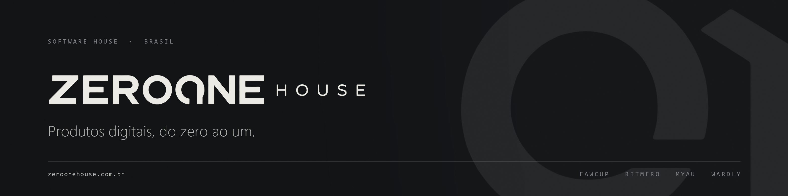

 

# Breno Luiz

### Founder @ ZeroOne House · Fullstack Developer

  Transformo ideias em produtos digitais: da arquitetura e interface ao deploy e à operação.

 

  

---

## Sobre mim

Sou desenvolvedor fullstack e fundador da **ZeroOne House**, onde desenvolvo e opero produtos digitais próprios.

Gosto de entender o produto por inteiro: modelagem de dados, experiência do usuário, integrações, infraestrutura, segurança e publicação em produção.

- 🎓 Cursando Engenharia de Software.
- 🛡️ Estudando cibersegurança, com interesse em segurança de aplicações e pentest.
- 🚀 Desenvolvendo produtos SaaS, APIs e aplicações web.
- ⚙️ Trabalhando com Docker, CI/CD, automação e infraestrutura.
- 📚 [Certificados e formações](https://github.com/brenoluizdev/certificates).

---

## ZeroOne House

  

**A casa por trás dos produtos.**

Desenvolvo, lanço e opero produtos digitais próprios, além de construir soluções sob medida. Cada projeto é uma oportunidade de transformar uma ideia em software útil, sustentável e pronto para produção.

 

<a href="https://zeroonehouse.com.br">
  <picture>
    <source media="(prefers-color-scheme: dark)" srcset="https://zeroonehouse.com.br/images/marca/wordmark-claro.png"/>
    
  </picture>
</a>

  

<a href="https://zeroonehouse.com.br"><strong>zeroonehouse.com.br →</strong></a>

---

## Produtos em destaque

<table>
<tr>
<td width="50%" valign="top">

### FawCup

`PRODUÇÃO` · Gestão esportiva

Plataforma para organizar campeonatos amadores: equipes, atletas, partidas, classificações e súmulas digitais. Inclui portal público e cobrança integrada.

<a href="https://fawcup.com.br"><strong>Acessar produto ↗</strong></a>

</td>
<td width="50%" valign="top">

### Wardly

`SECURITY` · Monitoramento

Monitora continuamente a configuração de segurança de domínios, incluindo TLS, HTTPS, HSTS, CSP, SPF e DMARC. Apresenta alertas claros e orientações para correção.

<a href="https://wardly.com.br"><strong>Acessar produto ↗</strong></a>

</td>
</tr>
<tr>
<td width="50%" valign="top">

### Ritmero

`PRODUCTIVITY` · Gestão do tempo

Agenda pessoal com metas diárias, semanais e mensais para acompanhar como o tempo é utilizado. Aplicação web instalável como PWA.

<a href="https://ritmero.com.br"><strong>Acessar produto ↗</strong></a>

</td>
<td width="50%" valign="top">

### MyAu

`PETS` · Serviços para animais

Plataforma voltada ao universo pet, conectando pessoas a serviços e oportunidades de adoção, além de cuidados para animais.

<a href="https://myau.com.br"><strong>Acessar produto ↗</strong></a>

</td>
</tr>
</table>

---

## Stack tecnológica

**Frontend & interfaces**

  

**Backend & bancos de dados**

  

**Infraestrutura & DevOps**

  

**Testes & ferramentas**

---

## GitHub em números

  

  

<strong>Contribuições ao longo do tempo</strong>

<picture>
  <source media="(prefers-color-scheme: dark)" srcset="https://raw.githubusercontent.com/brenoluizdev/brenoluizdev/output/github-contribution-grid-snake-dark.svg"/>
  <source media="(prefers-color-scheme: light)" srcset="https://raw.githubusercontent.com/brenoluizdev/brenoluizdev/output/github-contribution-grid-snake.svg"/>
  
</picture>

---

### Do zero ao um. Do código à produção.

<a href="https://zeroonehouse.com.br">ZeroOne House</a> ·
<a href="https://brenoluizdev.com.br/">Portfólio</a> ·
<a href="https://www.linkedin.com/in/brenoluizdev/">LinkedIn</a>

Construindo, aprendendo e melhorando um commit de cada vez.

