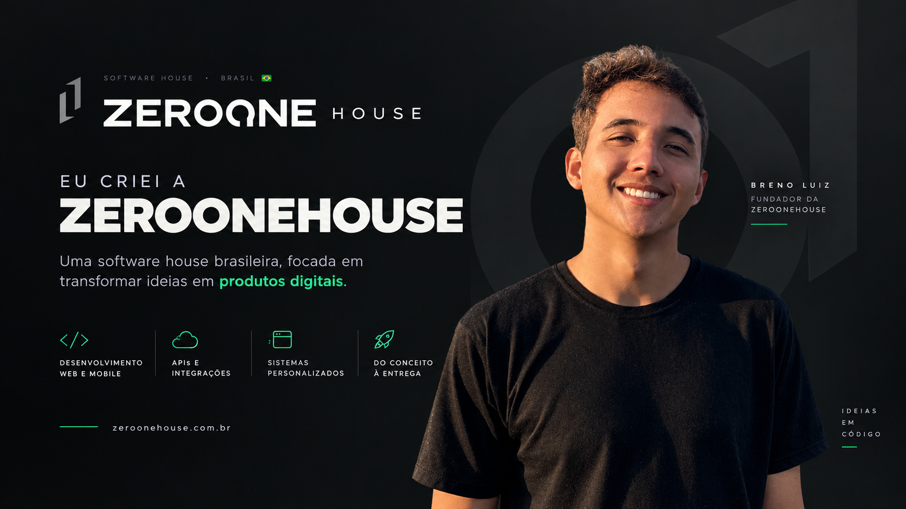

# Breno Luiz

**Software Engineer** · Fullstack · Fundador da [ZeroOne House](https://zeroonehouse.com.br)

Transformo ideias em produtos digitais: da arquitetura e interface ao deploy e à operação.

 

---

## Sobre

Sou desenvolvedor fullstack e fundador da **ZeroOne House**, onde concebo, desenvolvo e
**opero** produtos digitais próprios — do modelo de dados à infraestrutura.

Trabalho principalmente com **TypeScript** (React/Next.js no front, Node.js/NestJS no back),
**Flutter** para mobile e **Docker/CI** para colocar coisa no ar. Também estudo segurança de
aplicações: o foco hoje é construir software que se sustenta em produção, não só que funciona
na demonstração.

- 🎓 Cursando Engenharia de Software
- 🚀 Quatro produtos próprios no ar: **FawCup**, **Wardly**, **Ritmero** e **MyAu**
- 🛡️ Segurança de aplicações: hardening, monitoramento e correção
- 📜 [Certificados e formações](https://github.com/brenoluizdev/certificates)

---

## Em produção

Produtos que eu idealizei, construí e mantenho em operação.

| Produto | O que resolve | |
| --- | --- | :---: |
| **FawCup** | Gestão de campeonatos amadores: equipes, atletas, partidas, classificações e súmulas digitais, com portal público e cobrança integrada. | [↗](https://fawcup.com.br) |
| **Wardly** | Monitoramento contínuo da configuração de segurança de domínios — TLS, HTTPS, HSTS, CSP, SPF e DMARC — com alertas e orientação de correção. | [↗](https://wardly.com.br) |
| **Ritmero** | Planejamento pessoal com metas diárias, semanais e mensais para enxergar onde o tempo está indo. Instalável como PWA. | [↗](https://ritmero.com.br) |
| **MyAu** | Plataforma de serviços para animais de estimação, conectando tutores a serviços, cuidados e adoção. | [↗](https://myau.com.br) |

Arquitetura, escopo e decisões de cada um: **[zeroonehouse-cases](https://github.com/brenoluizdev/zeroonehouse-cases)**.

---

## Projetos em destaque

Código que dá para abrir, rodar e ler os testes.

| Projeto | O que é | Stack |
| --- | --- | --- |
| **[core-access-manager](https://github.com/brenoluizdev/core-access-manager)** | API + painel de usuários com JWT, RBAC, 45 testes e CI em Node 22/24. | `TypeScript` `Express` `Next.js` |
| **[bonktools](https://github.com/brenoluizdev/bonktools)** | Cliente headless para bonk.io via Socket.IO, publicado no npm. Sem browser, sem Chromium. | `TypeScript` `Socket.IO` |
| **[sefaz-monitor](https://github.com/brenoluizdev/sefaz-monitor)** | App de bandeja que monitora a disponibilidade da SEFAZ por UF, com backoff exponencial e auto-update. | `Go` `Win32` |
| **[claude-account-switcher](https://github.com/brenoluizdev/claude-account-switcher)** | Utilitário de bandeja para alternar entre contas isoladas do Claude Code CLI. | `C#` `.NET 8` |
| **[Futhero-Desktop](https://github.com/brenoluizdev/Futhero-Desktop)** | Launcher Electron para bonk.io e Haxball, com isolamento de segurança e empacotamento AppX. | `Electron` `TypeScript` |
| **[zeroonehouse-cases](https://github.com/brenoluizdev/zeroonehouse-cases)** | Estudos de caso dos produtos da ZeroOne House: problema, solução e arquitetura. | `Docs` |

---

## Stack

**Frontend & mobile**

  

**Backend & dados**

  

**Infra & DevOps**

  

**Testes & ferramentas**

---

## GitHub em números

---

### Do zero ao um. Do código à produção.

<a href="https://zeroonehouse.com.br">ZeroOne House</a> ·
<a href="https://brenoluizdev.com.br/">Portfólio</a> ·
<a href="https://www.linkedin.com/in/brenoluizdev/">LinkedIn</a> ·
<a href="mailto:dev.brenoluiz@gmail.com">dev.brenoluiz@gmail.com</a>

Goiânia, GO — aberto a oportunidades remotas.

